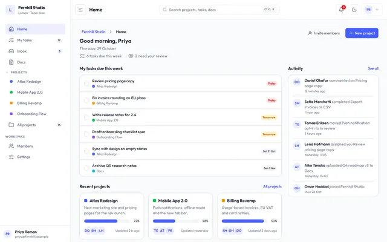
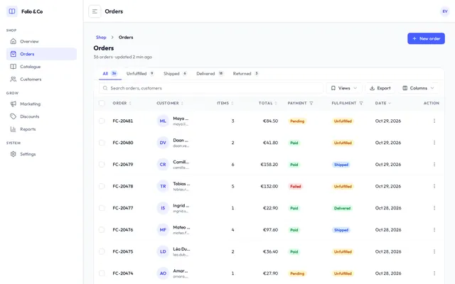
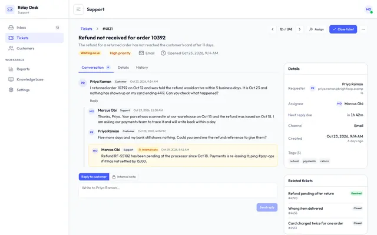
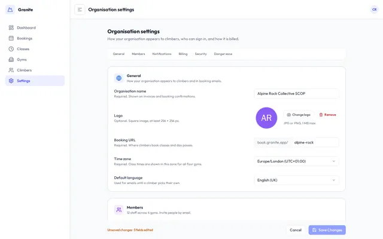
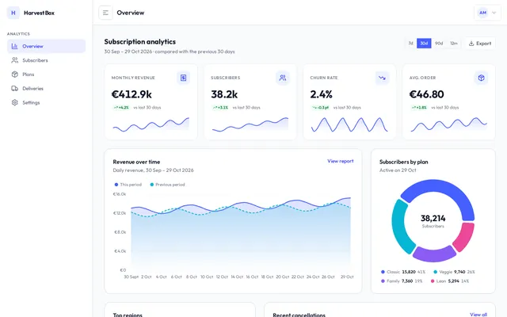
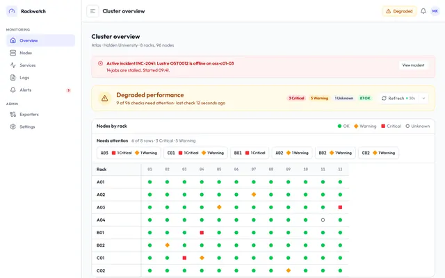

# Cosmos

Design system for dashboards and monitoring tools: a Tailwind 4 theme, React 19 components and
Recharts-based chart wrappers, documented in Storybook 10.

The [live Storybook](https://sckyzo.github.io/cosmos/) has every component with its docs and
stories (more than 3,500), in four themes, twelve accent colors, three densities, four corner radii
and both reading directions.

<table>
  <tr>
    <td width="33%" align="center">
      <a href="https://sckyzo.github.io/cosmos/?path=/story/examples-app-shell--content">
        <picture>
          <source media="(prefers-color-scheme: dark)" srcset="docs/images/example-app-shell-dark.webp">
          <source media="(prefers-color-scheme: light)" srcset="docs/images/example-app-shell-light.webp">
          
        </picture>
        <br>App Shell
      </a>
    </td>
    <td width="33%" align="center">
      <a href="https://sckyzo.github.io/cosmos/?path=/story/examples-list--content">
        <picture>
          <source media="(prefers-color-scheme: dark)" srcset="docs/images/example-list-dark.webp">
          <source media="(prefers-color-scheme: light)" srcset="docs/images/example-list-light.webp">
          
        </picture>
        <br>List
      </a>
    </td>
    <td width="33%" align="center">
      <a href="https://sckyzo.github.io/cosmos/?path=/story/examples-detail--content">
        <picture>
          <source media="(prefers-color-scheme: dark)" srcset="docs/images/example-detail-dark.webp">
          <source media="(prefers-color-scheme: light)" srcset="docs/images/example-detail-light.webp">
          
        </picture>
        <br>Detail
      </a>
    </td>
  </tr>
  <tr>
    <td width="33%" align="center">
      <a href="https://sckyzo.github.io/cosmos/?path=/story/examples-settings--content">
        <picture>
          <source media="(prefers-color-scheme: dark)" srcset="docs/images/example-settings-dark.webp">
          <source media="(prefers-color-scheme: light)" srcset="docs/images/example-settings-light.webp">
          
        </picture>
        <br>Settings
      </a>
    </td>
    <td width="33%" align="center">
      <a href="https://sckyzo.github.io/cosmos/?path=/story/examples-dashboard--content">
        <picture>
          <source media="(prefers-color-scheme: dark)" srcset="docs/images/example-dashboard-dark.webp">
          <source media="(prefers-color-scheme: light)" srcset="docs/images/example-dashboard-light.webp">
          
        </picture>
        <br>Dashboard
      </a>
    </td>
    <td width="33%" align="center">
      <a href="https://sckyzo.github.io/cosmos/?path=/story/examples-monitoring--content">
        <picture>
          <source media="(prefers-color-scheme: dark)" srcset="docs/images/example-monitoring-dark.webp">
          <source media="(prefers-color-scheme: light)" srcset="docs/images/example-monitoring-light.webp">
          
        </picture>
        <br>Monitoring
      </a>
    </td>
  </tr>
</table>

The six screens are the Storybook's Examples, shown light or dark to match your system. Each one
opens its story.

Cosmos is for React teams that build admin panels, dashboards, monitoring tools and status pages
and want one themeable, accessible set of components for them. It was extracted from
[rackscope](https://github.com/SckyzO/rackscope).

## Packages

| Package                                    | Description                                                                      | npm                                                                                                               |
| ------------------------------------------ | -------------------------------------------------------------------------------- | ----------------------------------------------------------------------------------------------------------------- |
| [`@sckyzo/cosmos-theme`](packages/theme)   | Tailwind 4 theme: design tokens, fonts, 4 themes, 12 accents                     | [](https://www.npmjs.com/package/@sckyzo/cosmos-theme)   |
| [`@sckyzo/cosmos-react`](packages/react)   | React 19 component library, ESM + CJS + DTS                                      | [](https://www.npmjs.com/package/@sckyzo/cosmos-react)   |
| [`@sckyzo/cosmos-charts`](packages/charts) | Chart wrappers (Recharts) that follow the theme and accent, published separately | [](https://www.npmjs.com/package/@sckyzo/cosmos-charts) |

The three packages share one version number: install the same version of each.

## Getting started

You need React 19 and Tailwind CSS 4 with its plugin for your bundler. The steps below are the
short version; the [full guide](docs/getting-started.md) explains each line and has a recipe for
Vite and one for Next.js.

### 1. Install

```bash
npm install @sckyzo/cosmos-theme @sckyzo/cosmos-react
```

### 2. Set up the styles

In the CSS file your app imports at its root. The `@source` line is mandatory: Tailwind does not
scan `node_modules`, so without it no Cosmos class is generated and every component renders
unstyled.

```css
@import 'tailwindcss';

/* Required. The path is relative to this file. */
@source '../node_modules/@sckyzo/cosmos-react/dist/**/*.{js,cjs}';

@import '@sckyzo/cosmos-theme/tailwind';
@import '@sckyzo/cosmos-theme/vars';
@import '@sckyzo/cosmos-theme/fonts';
```

### 3. Use a component, and set the theme on `<html>`

```tsx
import { Button } from '@sckyzo/cosmos-react';

export default () => <Button>Hello Cosmos</Button>;
```

```html
<html lang="en" class="dark" data-accent="teal"></html>
```

The theme, the accent, the font, the text size, the density, the corner radius and the reading
direction are all a class or an attribute on `<html>`.

## Documentation

- [Getting started](docs/getting-started.md): requirements, install, the CSS setup explained, and
  recipes for Vite and Next.js (App Router).
- Guides
  - [Appearance](docs/guides/appearance.md): themes, accents, fonts, text size, density, radius,
    the pickers, and the theme without Tailwind.
  - [Tokens and focus](docs/guides/tokens.md): the design tokens and the focus utilities.
  - [Charts](docs/guides/charts.md): `@sckyzo/cosmos-charts`.
  - [Optional entries](docs/guides/optional-entries.md): `/code`, `/editor` and `/map`, and
    their peer dependencies.
  - [Right to left](docs/guides/right-to-left.md).
  - [Refs and routing](docs/guides/refs-and-routing.md): refs, and sending links through your router.
- Components, by Storybook group: [Tables](docs/components/tables.md),
  [Data](docs/components/data.md), [Feedback](docs/components/feedback.md),
  [Monitoring](docs/components/monitoring.md), [Navigation](docs/components/navigation.md),
  [Lists](docs/components/lists.md), [Chat](docs/components/chat.md),
  [Forms](docs/components/forms.md), [Layout](docs/components/layout.md),
  [Media](docs/components/media.md) and [variants worth knowing](docs/components/variants.md).
- [Themes and accents specification](docs/specs/themes-accents.md): how the themes and accents are built.
- [Storybook](https://sckyzo.github.io/cosmos/): every component, with its props, stories and
  accessibility checks. Its Welcome page lists the components by group and has a search.
- [cosmos-demo](https://github.com/SckyzO/cosmos-demo): a demo app built only from Cosmos and
  installed from npm, with routes, shared state and the appearance settings on every page. In
  progress; its plan is [cosmos-demo#1](https://github.com/SckyzO/cosmos-demo/issues/1).

The [documentation index](docs/README.md) lists the same pages.

### Storybook groups

Stories are grouped by what a component does, not by where its file lives (Storybook's
[story-hierarchy convention](https://storybook.js.org/docs/writing-stories/naming-components-and-hierarchy)):

```text
Welcome → Examples → Foundations → Typography → Atoms → Actions → Forms → Data
       → Media → Status → Monitoring → Feedback → Overlays → Navigation
       → Layout → Lists → Chat → Tables → Settings → Charts
```

Notable groups:

- **Examples**: six screen recipes, each in its states (content, empty, loading, error, extreme content, phone): App Shell, List, Detail, Settings, Dashboard and Monitoring; then the auth forms and the error page
- **Typography**: Headings, Paragraphs, Text, Blockquote, Kbd, Figure, Link, List, Description List, Divider
- **Forms**: inputs, selects, pickers, upload and editing controls (Input, Select, Combobox, MultiSelect, TagInput, DatePicker, Slider, Rich Text Editor, …)
- **Media**: Carousel, Image Grid, Video Embed, CodeBlock, code highlighting, Map View
- **Charts**: `@sckyzo/cosmos-charts`, one entry per chart type: line and area, bar and column, donut, radial bar, gauges, realtime, sparkline, treemap, heatmap, calendar, radar, scatter and bubble, box plot, range bar, mixed, bump, funnel, waterfall and world map

## Development (everything in Docker)

The host needs only `docker`, `git`, `gh`, `make` and `bash`: Node, pnpm and Playwright run in
the `cosmos-dev` image.

```bash
make build-image    # Build cosmos-dev image (first time only)
make install        # pnpm install + Playwright browsers, inside the container
make storybook      # Start Storybook on http://localhost:6006
make check-changed  # Before every push: the CI pipeline cut down to what you changed
make ci             # The full CI pipeline, one step after the other
make test           # Unit + e2e tests only
make build          # Build all package dists
make help           # See every available target
```

`make ci` mirrors `.github/workflows/ci.yml` (lint, format:check, typecheck,
build, storybook:build, tests) and bails on the first failure. `make
check-changed` runs the part of it the changed files can break, and all of
it when a change touches the theme, the config or the dependencies.

Playwright browsers are not baked into the dev image: their revision is tied to
the exact Playwright version in the lockfile. `make install` fetches them into
`.cache/ms-playwright` (gitignored), and the test targets top them up if a
version bump needs a new revision. After pulling a Playwright bump, `make
install` is enough; no image rebuild.

Alternative wrapper (`./devctl`) for ad-hoc commands:

```bash
./devctl shell                  # Interactive shell inside cosmos-dev
./devctl run pnpm <anything>    # Arbitrary pnpm command
./devctl storybook              # Storybook dev server
```

## Versions

| Tool         | Version             |
| ------------ | ------------------- |
| Node         | ≥22 (dev image: 26) |
| pnpm         | 10                  |
| React        | 19                  |
| Tailwind CSS | 4                   |
| Storybook    | 10                  |
| Vite         | 8                   |
| TypeScript   | 6                   |
| Playwright   | 1.6x                |

The packages are below 1.0, so a breaking change bumps the minor version (0.4.0 to 0.5.0). The
[release notes](https://github.com/SckyzO/cosmos/releases) and the `CHANGELOG.md` of each package
list breaking changes under "BREAKING CHANGES": read them before you bump.

## Contributing

See [CONTRIBUTING.md](CONTRIBUTING.md). All commits must be signed (SSH
signing). The repo uses Conventional Commits: `feat`, `fix`, `refactor`,
`chore`, `docs`, `test`, `build`, `ci`, `perf`, `style`, `revert`.

## License

MIT, see [LICENSE](LICENSE).
