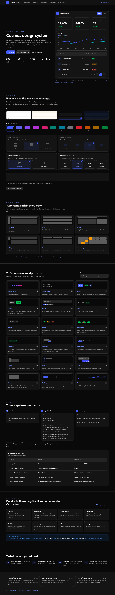

# Cosmos

Design system for dashboards and monitoring tools: a Tailwind 4 theme, React 19 components and
Recharts-based chart wrappers, documented in Storybook 10.

**Live demo:** [sckyzo.github.io/cosmos](https://sckyzo.github.io/cosmos/): every component with its docs and
stories (more than 1,800), in four themes, twelve accent colors, three densities, four corner radii
and both reading directions.

<picture>
  <source media="(prefers-color-scheme: dark)" srcset="docs/images/welcome-dark.png">
  <source media="(prefers-color-scheme: light)" srcset="docs/images/welcome-light.png">
  
</picture>

Cosmos provides a shared CSS theme and a library of React components extracted
and refined from [rackscope](https://github.com/SckyzO/rackscope), reusable
across multiple projects (monitoring-hub, monitoring-hub-website, future
portals, and rackscope itself eventually).

## Packages

| Package                                    | Description                                                                      | npm                                                                                                               |
| ------------------------------------------ | -------------------------------------------------------------------------------- | ----------------------------------------------------------------------------------------------------------------- |
| [`@sckyzo/cosmos-theme`](packages/theme)   | Tailwind 4 theme — design tokens, fonts, 4 themes, 12 accents                    | [](https://www.npmjs.com/package/@sckyzo/cosmos-theme)   |
| [`@sckyzo/cosmos-react`](packages/react)   | React 19 component library — ESM + CJS + DTS                                     | [](https://www.npmjs.com/package/@sckyzo/cosmos-react)   |
| [`@sckyzo/cosmos-charts`](packages/charts) | Chart wrappers (Recharts) that follow the theme and accent, published separately | [](https://www.npmjs.com/package/@sckyzo/cosmos-charts) |

The three packages share one version number: install the same version of each.

## Themes and accents

Settings on the `<html>` element restyle every component:

- the **theme**, one class: none for `light`, `sand`, `dark` (neutral black/gray) or
  `deep-blue` (navy);
- the **accent**, a `data-accent` attribute: none for `blue`, or `indigo`, `violet`,
  `purple`, `rose`, `teal`, `cyan`, `graphite`, `red`, `orange`, `amber`, `green`;
- the **font**, a `data-font` attribute: none for Outfit, or `inter`, `plex`,
  `montserrat`, `open-sans`, `system`;
- the **text size**, a `data-text-size` attribute: none for the default, or `sm`, `lg`,
  `xl`. It scales the text, not the spacing;
- the **density**, a `data-density` attribute: none for the default, or `compact`,
  `comfortable`. It moves the height of controls and the padding of rows, not the gaps;
- the **corner radius**, a `data-radius` attribute: none for the default, or `none`, `sm`, `lg`.
  It rescales every `rounded-*` corner but `rounded-full`, which stays round;
- the **reading direction**, the native `dir` attribute: none for left to right, or `rtl`. Every
  component mirrors.

```html
<html
  class="sand"
  data-accent="teal"
  data-font="inter"
  data-text-size="lg"
  data-density="compact"
  data-radius="lg"
  dir="rtl"
></html>
```

The theme tokens that `scripts/check-contrast.mjs` in the theme package checks on every CI run
(body, muted and accent text, white text on the accent) meet WCAG AA in every theme and accent
pair. Every story passes axe on every CI run too, its color contrast in light, sand and deep blue,
and passes again under `dir="rtl"`.
`@sckyzo/cosmos-react` ships the pickers (`Customizer`, a side panel with every setting;
`AppearanceSettings` for a settings page; `AppearanceMenu` for a top bar) and `applyAppearance`
to set them. Details in the [theme README](packages/theme#themes--accents).

## Apps

| App                                | Purpose                                          | URL                                |
| ---------------------------------- | ------------------------------------------------ | ---------------------------------- |
| [`apps/storybook`](apps/storybook) | Component showcase + visual testing + a11y + MCP | <https://sckyzo.github.io/cosmos/> |

The Storybook is the canonical reference — every component has at least one
story, autodocs is enabled, and the **Welcome** page counts, groups and searches every component,
read from Storybook's story index so it stays in sync.

## Sidebar groups

Stories are organised by **responsibility**, not file location (Storybook
[story-hierarchy convention](https://storybook.js.org/docs/writing-stories/naming-components-and-hierarchy)):

```text
Welcome → Examples → Foundations → Typography → Atoms → Actions → Forms → Data
       → Media → Status → Monitoring → Feedback → Overlays → Navigation
       → Layout → Lists → Chat → Tables → Settings → Charts
```

Notable groups:

- **Examples** — six screen recipes, each in its states (content, empty, loading, error, extreme content, phone): App Shell, List, Detail, Settings, Dashboard and Monitoring; then the auth forms and the error page
- **Typography** — Headings, Paragraphs, Text utilities, Blockquote, Kbd, Figure, Link, List, Description List, Divider
- **Forms** — 26 controls (Input, Select, Combobox, MultiSelect, TagInput, DatePicker single + range, …)
- **Media** — Carousel, Image Grid, Video Embed, CodeBlock
- **Charts** — `@sckyzo/cosmos-charts`, one entry per chart type: line & area, bar & column, donut, radial bar, gauges,
  realtime, sparkline, treemap, heatmap, radar, scatter & bubble, box plot, range bar, mixed

## Development (everything in Docker)

The host needs only `docker`, `git`, `gh`, `make`, `bash`. No Node, no pnpm,
no Playwright on the host.

```bash
make build-image    # Build cosmos-dev image (first time only)
make install        # pnpm install + Playwright browsers, inside the container
make storybook      # Start Storybook on http://localhost:6006
make check-changed  # Before every push: the CI pipeline cut down to what you changed
make ci             # Run the FULL CI pipeline locally
make test           # Unit + e2e tests only
make build          # Build all package dists
make help           # See every available target
```

`make ci` mirrors `.github/workflows/ci.yml` (lint, format:check, typecheck,
build, storybook:build, tests) and bails on the first failure. `make
check-changed` runs the part of it the changed files can break, and all of
it when a change touches the theme, the config or the dependencies.

Playwright browsers are not baked into the dev image: their revision is tied to
the exact Playwright version in the lockfile. `make install` fetches them into
`.cache/ms-playwright` (gitignored), and the test targets top them up if a
version bump needs a new revision. After pulling a Playwright bump, `make
install` is enough; no image rebuild.

Alternative wrapper (`./devctl`) for ad-hoc commands:

```bash
./devctl shell                  # Interactive shell inside cosmos-dev
./devctl run pnpm <anything>    # Arbitrary pnpm command
./devctl storybook              # Storybook dev server
```

## Versions

| Tool         | Version             |
| ------------ | ------------------- |
| Node         | ≥22 (dev image: 26) |
| pnpm         | 10                  |
| React        | 19                  |
| Tailwind CSS | 4                   |
| Storybook    | 10                  |
| Vite         | 8                   |
| TypeScript   | 6                   |
| Playwright   | 1.6x                |

## Contributing

See [CONTRIBUTING.md](CONTRIBUTING.md). All commits must be signed (SSH
signing). The repo uses Conventional Commits — `feat`, `fix`, `refactor`,
`chore`, `docs`, `test`, `build`, `ci`, `perf`, `style`, `revert`.

Two-stage refactor rule (cf. PROFILE_DEV.md) is **lifted for Cosmos**: it
currently has no published consumers, so breaking changes are merged in a
single commit rather than via deprecation cycles. For every OTHER repo in the
stack the rule still stands.

## License

MIT — see [LICENSE](LICENSE).
